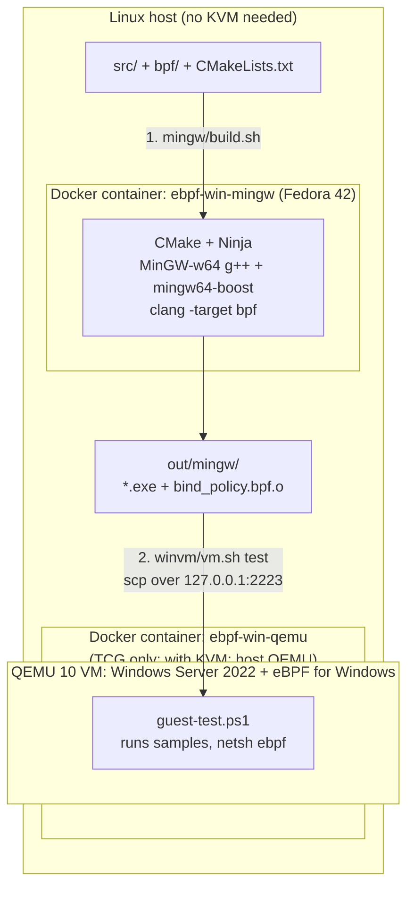
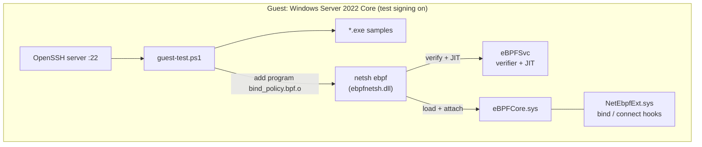
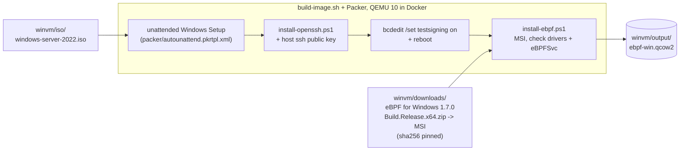

# Windows eBPF Sandbox

A Windows companion to
[QEMU-eBPF-Sandbox](https://github.com/JohnBlue-git/QEMU-eBPF-Sandbox). It
keeps the Boost.Asio design and runs it, together with an eBPF program, on a
real Windows VM. Everything runs from a Linux host. You do not need a Windows
PC or KVM.

- **Build:** MinGW-w64, Boost and clang (bpf target) in a Docker container
  cross-compile the samples and the eBPF object.
- **Test:** a Windows Server 2022 VM with
  [eBPF for Windows](https://github.com/microsoft/ebpf-for-windows) runs them.
  Without KVM, QEMU 10 runs in a second Docker container (TCG). With KVM,
  the host's `qemu-system-x86_64` runs the VM.

| Output | What it shows |
|---|---|
| `asio_smoke_test.exe` | Boost.Asio C++20 coroutine action loop |
| `file_change_monitor.exe` | `ReadDirectoryChangesW` events go into the action loop |
| `etw_process_monitor.exe` | `Microsoft-Windows-Kernel-Process` ETW events go into the action loop |
| `bind_policy.bpf.o` | eBPF `cgroup/bind4` + `cgroup/bind6` programs: reject binds to port 4444 |

## Quick start

```sh
# One time (about 1 hour without KVM): see docs/winvm.md for the ISO
./winvm/build-image.sh                  # ISO -> winvm/output/ebpf-win.qcow2

# Every change
./mingw/build.sh                        # build  -> out/mingw/   (about 1 min)
./winvm/vm.sh test                      # test on Windows        (about 5-10 min without KVM)
```

`mingw/build.sh [Release|Debug|RelWithDebInfo|MinSizeRel]` takes the CMake
build type (default `Release`). Overrides: `IMAGE` (Docker image tag, default
`ebpf-win-mingw`), `OUT_DIR` (default `out/mingw`).

`vm.sh test` ends with `All checks passed.` after these checks:

1. `asio_smoke_test.exe` completes its action.
2. `file_change_monitor.exe` reports a new file.
3. `etw_process_monitor.exe` reports a process start.
4. The eBPF verifier accepts both sections of `bind_policy.bpf.o`.
5. With `cgroup/bind4` attached, a bind to port 4444 fails and a bind to 4445
   works. After unload, port 4444 works again.

## How it fits together

### Main flow: build in Docker, test in a QEMU Windows VM



### Inside the VM



`vm.sh` never starts Windows from the base image directly. It runs on a
copy-on-write overlay. `vm.sh test` creates a new overlay, so the test starts
from the same clean Windows, unless the VM is already running (`vm.sh start`):
then it reuses that VM and its overlay.

### One time: create the base image



## Repository layout

```
.
├── CMakeLists.txt                 samples + eBPF object
├── ebpf-for-windows.env           eBPF for Windows version + sha256 pins (CMake and winvm/)
├── src/
│   ├── actions/                   Boost.Asio ActionLoop + smoke test
│   ├── file_monitor/              ReadDirectoryChangesW sample (Windows only)
│   └── etw/                       Kernel-Process ETW sample (Windows only)
├── bpf/bind_policy.bpf.c          eBPF for Windows cgroup/bind4 + bind6 program
├── cmake/toolchains/              MinGW-w64 toolchain file (Fedora paths)
├── mingw/                         STEP 1: build in Docker
│   ├── Dockerfile                 Fedora 42 + CMake + MinGW + Boost + clang
│   └── build.sh                   -> build/mingw/, out/mingw/
├── winvm/                         STEP 2: Windows VM with eBPF for Windows
│   ├── vm.sh                      every run: test | start | ssh | stop | reset | status
│   ├── build-image.sh             one time: ISO + MSI -> output/ebpf-win.qcow2
│   └── ...                        full file list: docs/winvm.md
├── docs/
│   ├── winvm.md                   VM host setup, files, options
│   └── WINDOWS_DESIGN.md          Linux hooks vs Windows, eBPF runtime choices
└── build/, out/                   generated, not in Git
```

## Notes

- **eBPF for Windows version:** 1.7.0 (pre-release). The version and the
  sha256 of the headers tarball and of the Release build zip (which contains
  the MSI) are in `ebpf-for-windows.env`.
  `CMakeLists.txt` and `winvm/build-image.sh` both read it.
- **JIT, not native:** `bind_policy.bpf.o` loads directly through the eBPF
  service's verifier and JIT. The VM uses the MSI from the release's
  `Build.Release.x64.zip`: the standalone `.msi` asset is native-only and
  cannot load `.o` files. Native mode (`.o` -> signed `.sys`) needs MSVC
  and the WDK; this project does not use it. See
  [docs/WINDOWS_DESIGN.md](docs/WINDOWS_DESIGN.md).
- **Test signing:** eBPF for Windows drivers are not Microsoft-signed, so the
  VM runs with test signing on. Do not do this on a production machine.
- **XDP** is not included. It needs the separate XDP for Windows extension.
- **ETW and file monitor samples** only observe. They cannot block or undo
  operations. See [docs/WINDOWS_DESIGN.md](docs/WINDOWS_DESIGN.md).
